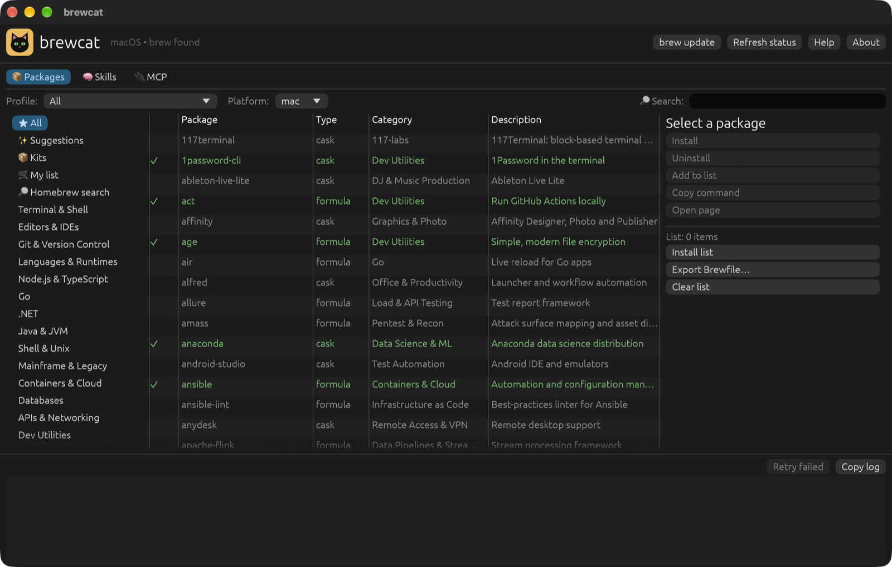

# brewcat

**Set up a Mac or Linux machine in minutes: pick what you do, see a starter kit, confirm, install.**
brewcat is a window and a command line on top of [Homebrew](https://brew.sh). It suggests packages for your
profile (dev, SRE, QA, security, data, design, DJ, office, gamer…), shows what will change, and **always asks
before it installs anything**. It is a single native binary written in Rust.

    brew install --cask 1985epma/brewcat/brewcat     # macOS app (Launchpad, Spotlight, Dock); Apple Silicon only
    brew install 1985epma/brewcat/brewcat            # the `brewcat` command + window, macOS and Linux

## Quick start

1. Open brewcat (`brewcat`, or the app in Launchpad). On the first launch it asks what you do and shows a starter kit.
2. Pick a **kit** or add packages to **My list** (double-click a package, or **Add to list**). You see what is new, what is
   already installed and what Homebrew will pull in as dependencies, before anything runs. **F1** opens the help.
3. Confirm. If a package fails, the others still install, and **Retry failed** runs only the ones that failed.

Prefer the terminal? `brewcat install "terraform + aws"` shows the same plan and asks the same question.
Something wrong? `brewcat doctor` checks Homebrew, Rosetta, tap trust, the display and graphics libraries and the app
bundle, and prints how to fix it.

## What it does

- Categories, search, and filters by platform and by profile: Dev, SRE/Cloud, QA, Data, Network, Security, Design, DJ,
  Office, Vendors (Microsoft, Google, Amazon, Anthropic, Cursor, Kiro, xAI, Oracle, IBM, SAP, SUSE, Red Hat, HashiCorp,
  Apple, JetBrains…), 117-labs and Gamer
- ✨ Suggestions based on what you already have installed
- 🧪 **117-labs** profile: products built by 1985epma (`k8scli`, `epma-windows-usb-creator`, `117terminal`, `epma-system-data`), installable in one click
- 🏗️ SRE/Cloud profile: Terraform, AWS, Google Cloud, Azure, Railway, Kubernetes, observability
- 🧰 Dev areas: Node.js, Go, .NET, Java, Shell/Unix, Mainframe
- 🔎 Search any Homebrew package by name (not just the curated catalog)
- ✅ Always asks for confirmation before installing
- 📦 Kits (Web Full-Stack, DevOps, Retro Gaming, Streamer…)
- 🧠 Skills: scan a GitHub repo (e.g. `anthropics/skills`) or local folder and install skills into Claude, Kiro and VS Code
- 🔌 MCP: install MCP servers (presets or custom) into the same three tools
- 🛒 Your own list: install everything at once or export a Brewfile
- 🔗 Each package shows its formulae.brew.sh page so you can research before installing

## Install with Homebrew

    brew tap 1985epma/brewcat
    brew trust 1985epma/brewcat
    brew install brewcat
    brewcat

Recent Homebrew versions refuse to load formulae from third-party taps until you trust them. If you see
`Refusing to load formula … from untrusted tap`, run `brew trust 1985epma/brewcat` once (then
`brew update && brew upgrade brewcat`).

The formula builds brewcat from source with Rust (Homebrew installs it for you), so the first install takes a few minutes.
Because it is built on your own machine it is not tied to Apple Silicon; only the cask and the `.dmg` are.

## Upgrading from 0.1.x

0.2.0 is a rewrite in Rust: the same catalog, kits, Skills/MCP installers and command line (the output of `search`,
`list`, `kits`, `export` and `install -n` is identical), but no Python or Tk. Versions are plain `X.Y.Z` from now on.

    brew update && brew upgrade brewcat      # formula: builds from source, a few minutes
    brew upgrade --cask brewcat              # cask: Apple Silicon only
    brewcat --install-app                    # macOS: refresh the Launchpad shortcut

The Launchpad shortcut made by 0.1.x started Python and stops working after the upgrade; `brewcat --install-app`
(or just starting `brewcat` once) replaces it. `python-tk` is not needed any more: remove it if nothing else uses it
(`brew uses --installed python-tk`). `BREWCAT_BRANDED` and `BREWCAT_HIDDEN_APP` no longer exist.

## Appear in Launchpad / Applications (macOS)

- `brew install --cask 1985epma/brewcat/brewcat` installs **brewcat.app** into /Applications (Launchpad, Spotlight, Dock).
- With the formula (`brew install brewcat`), the first time you run `brewcat` it creates
  `~/Applications/brewcat.app` automatically, so it shows up in Launchpad and Spotlight. Re-create it with
  `brewcat --install-app`; opt out with `BREWCAT_NO_APP=1`.

## Other install options

**macOS (.dmg), Apple Silicon only:** download `brewcat-<version>.dmg` from [Releases](https://github.com/1985epma/homebrew-brewcat/releases), drag *brewcat* to Applications. On an Intel Mac use the formula. The app is not notarized by Apple, so macOS may say it "could not verify brewcat is free of malware". Fix it once with:

    xattr -dr com.apple.quarantine /Applications/brewcat.app

(or System Settings → Privacy & Security → *Open Anyway*). Installing with `brew` avoids this warning entirely.

**Linux (script):**

    curl -fsSL https://raw.githubusercontent.com/1985epma/homebrew-brewcat/main/install.sh | bash

Needs `git` and a Rust toolchain (`brew install rust`, or [rustup](https://rustup.rs)). It builds the latest released tag
(not the moving `main` branch) in `~/.local/share/brewcat`, which takes a few minutes, then installs `brewcat` to
`~/.local/bin` and adds a desktop entry. Pin a version with `BREWCAT_REF=v0.2.0` (the first release written in Rust;
older tags cannot be built).
Review the script before piping it to `bash`: https://github.com/1985epma/homebrew-brewcat/blob/main/install.sh

**Build the .dmg yourself (macOS):** `./scripts/build-dmg.sh` (needs Rust; `UNIVERSAL=1` builds arm64 + x86_64 in one app).

**Linux, the window:** it needs a graphical session and OpenGL/EGL or Vulkan drivers (Debian/Ubuntu:
`sudo apt install libegl1 libgl1`). The command line works without them, also on a headless box.

## Environment variables

| Variable | Effect |
|---|---|
| `BREWCAT_BREW` | Path of the `brew` to use, for a Homebrew in an unusual place. Empty: behave as if Homebrew were not installed. |
| `BREWCAT_NO_WELCOME=1` | Do not show the first-run welcome. |
| `BREWCAT_NO_APP=1` | macOS: do not create `~/Applications/brewcat.app` automatically. |
| `BREWCAT_REF`, `BREWCAT_HOME` | `install.sh` only: the tag to build (default: the latest) and where its sources go (default `~/.local/share/brewcat`). |

## Command line

    brewcat --help        full help
    brewcat --version     version and OS
    brewcat doctor        checks Homebrew, Rosetta, tap trust, display and graphics, app bundle… and prints how to fix them
    brewcat doctor --json machine-readable (exit code 1 if a check fails)
    brewcat doctor --report  redacted Markdown to paste into a bug report (no user name, host or home path)
    brewcat search terraform -p sre          search the curated catalog without opening a window
    brewcat list -p security --not-installed list what you still miss in a profile (✓ = installed)
    brewcat kits -p sre                      list kits (brewcat kits "git pro" shows one kit)
    brewcat install "terraform + aws" -n     plan only; add --yes to skip the confirmation
    brewcat export "git pro" -o Brewfile     write a Brewfile (brew bundle --file=Brewfile)
    brewcat profiles                         profile names for -p (dev, sre, qa, security, gamer…)
    brewcat --install-app macOS: (re)create ~/Applications/brewcat.app

Exit codes: 0 success, 1 nothing found / a check or operation failed, 2 invalid usage.
`--json` is available on `search`, `list`, `kits` and `doctor`; data goes to stdout, messages to stderr.

## Run from source

    cargo run --release                      # the window
    cargo run --release -- search jq         # the command line

## Development

    cargo fmt --check && cargo clippy --all-targets -- -D warnings && cargo test
    cargo test --no-default-features          # command line only: no window, no graphics libraries needed
    cargo run --example validate_catalog      # every catalog package must still exist in Homebrew (needs curl)

The window is the `gui` feature, on by default. CI runs the same on Linux and macOS; a weekly job re-validates the
catalog against Homebrew's API. The command-line tests run the real binary against a fake `brew` (see `BREWCAT_BREW`);
the window's logic is tested without opening one, including real pointer clicks fed to egui.

    src/main.rs        entry point: the command line first, the window when there is no command
    src/cli.rs         arguments and commands (search, list, kits, install, export, profiles)
    src/doctor.rs      `brewcat doctor` and the redacted report
    src/catalog.rs     the curated catalog (data/catalog.json) and its lookups
    src/plan.rs        "what will change" before an install (brew --dry-run)
    src/brewenv.rs     finding brew, running it natively on Apple Silicon, retrying one package at a time
    src/brewrunner.rs  runs brew in its own process group and can stop it
    src/extras_core.rs Skills and MCP installers: repository parsing, symlink checks, config edits
    src/launcher.rs    the macOS shortcut for Launchpad
    src/gui/           the egui window: pure state (tested), worker threads, dialogs, tabs
    tests/             the binary against a fake brew, and the catalog checks

The catalog is `data/catalog.json`: one JSON object per package on its own line, then the kits, the categories of each
profile and the "essentials" suggested for it. To add a package, add a line to `items`:

    {"name": "ripgrep", "kind": "formula", "category": "Terminal & Shell", "desc": "…", "profiles": ["dev"], "platforms": ["mac", "linux"], "tags": ["cli", "search"]}

`kind` is `formula` or `cask` (casks are macOS only); `tap`, `groups` and `homepage` are optional; a package that is also
useful in another area lists that category in `groups`. `cargo test` rejects duplicate keys, kits or essentials that point
at missing packages and categories without packages.

## Releasing (maintainers)

    scripts/release.sh 0.2.1                 # dry run: checks everything and prints the plan
    scripts/release.sh 0.2.1 --yes --notes "What changed"

The version lives in `Cargo.toml` only (`X.Y.Z`); the script bumps it and `Cargo.lock`, tags, builds the `.dmg`, creates
the GitHub release and sets the formula and cask sha256 from what GitHub actually serves. Tags are never moved.

## Where things are installed

| Target | Skills (user / project) | MCP config (user / project) |
|---|---|---|
| Claude | `~/.claude/skills` / `.claude/skills` | `~/.claude.json` / `.mcp.json` |
| Kiro | `~/.kiro/skills` / `.kiro/skills` | `~/.kiro/settings/mcp.json` / `.kiro/settings/mcp.json` |
| VS Code | `~/.copilot/skills` / `.github/skills` | user `mcp.json` / `.vscode/mcp.json` |

MCP configs are edited in place and a `.bak` copy is kept.

## License

[MIT](LICENSE)
